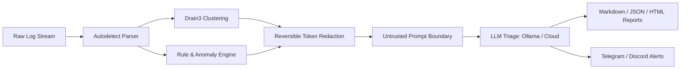

# LogLens — AI-Assisted Security Log Triage

[](https://github.com/ItsAdi22/LogLens-AI-Assisted-Security-Log-Triage/actions/workflows/ci.yml)
[](https://github.com/ItsAdi22/LogLens-AI-Assisted-Security-Log-Triage/actions/workflows/release.yml)
[](LICENSE)
[](pyproject.toml)
[](https://github.com/ItsAdi22/LogLens-AI-Assisted-Security-Log-Triage/actions/workflows/codeql.yml)

> **Lightweight, local-first, privacy-respecting log triage for self-hosters, sysadmins, and DevOps.**

LogLens transforms noisy security logs into structured, high-confidence forensic intelligence. It ingests system and web logs, compresses them into signature templates using **Drain3**, matches 18+ deterministic **MITRE ATT&CK rules**, and optionally routes **redacted, injection-safe cluster summaries** to local LLMs (Ollama) or cloud providers to explain incidents, evaluate severity, and recommend actionable containment steps.

---

## 🏛️ Architecture & Pipeline



---

## 🔒 Privacy & Defense-in-Depth

- **100% Offline by Default**: Designed to run seamlessly with local LLMs via Ollama. No data ever leaves your perimeter without explicit configuration and consent.
- **High-Entropy Token Redaction**: Reversible masking scrubs IPv4, IPv6, email addresses, Bearer tokens, JWTs, and AWS credentials *prior* to LLM analysis.
- **Extreme Token Efficiency**: Drain3 clusters compress 50,000+ raw log lines into ~15 representative templates—reducing LLM token consumption and costs by **over 99%**.
- **Adversarial Prompt-Injection Defense**: Log messages are strictly quarantined within `<untrusted_log_cluster>` boundary tags. The LLM has zero tools, zero network egress, and zero execution privileges.
- **XSS & SQLi Proof**: Dynamic report fields are escaped using `html.escape()`; storage relies 100% on parameterized SQLite queries.

---

## 🚀 Quickstart (3 Commands)

### 1. Install LogLens
```bash
# Recommended via pipx
pipx install loglens

# Or standard pip
pip install loglens
```

### 2. Analyze Logs in Rule-Only Offline Mode (Zero LLM setup required)
```bash
loglens analyze /var/log/auth.log --no-llm
```

### 3. Triage with Local Ollama and Generate an HTML Dashboard
```bash
loglens analyze /var/log/nginx/access.log --llm --provider ollama --out report.html
```

---

## 🐳 Docker Quickstart

Run LogLens in a lightweight, non-root isolated container:

```bash
# Analyze host logs mounted read-only
docker run --rm -v /var/log:/logs:ro ghcr.io/itsadi22/loglens:v0.1.0 analyze /logs/auth.log --no-llm

# Run with full Ollama stack via docker-compose
docker compose up -d
docker compose exec loglens loglens analyze /logs/auth.log --llm --provider ollama
```

---

## 📊 Comparison Matrix

| Capability | `grep` / `fail2ban` | Wazuh / Elastic SIEM | **LogLens** |
|---|---|---|---|
| **Setup Time** | < 5 mins | Days / Complex | **< 2 minutes** |
| **Footprint** | Tiny | 4GB+ RAM JVM cluster | **< 65MB RAM constant** |
| **Clustering** | ❌ None | ❌ Complex indexing | **✅ Drain3 automatic template mining** |
| **AI Explanation** | ❌ None | ❌ None / Expensive add-on | **✅ Local Ollama, Gemini, OpenAI, Claude** |
| **Reversible Redaction**| ❌ None | ❌ Manual filters | **✅ Built-in multi-pattern redactor** |
| **Rule Engine** | Regex / Python | XML decoders | **✅ 18+ MITRE ATT&CK YAML rules** |
| **Prompt Injection Safe**| N/A | N/A | **✅ Delimited container + schema enforcement** |
| **Alerting** | Email / Scripts | Complex alerting engine | **✅ Telegram, Discord, Webhook with dedupe** |

---

## ⚡ CLI Command Overview

```bash
# Analyze logs from file or streamed stdin
loglens analyze /var/log/auth.log --llm --provider ollama --out incident.md
cat /var/log/nginx/access.log | loglens analyze - --format nginx --fail-on high

# Real-time continuous monitoring with Telegram alerts
loglens watch /var/log/auth.log --interval 5s --notify telegram

# Query historical incidents from local SQLite store
loglens report --since 24h --format html --out daily_digest.html

# Inspect, validate, and test MITRE ATT&CK detection rules
loglens rules list
loglens rules validate custom_rules.yml
loglens rules test custom_rules.yml --against /var/log/auth.log

# Verify LLM provider connectivity
loglens providers test --provider ollama
```

---

## 🎯 Evaluation Benchmark Results

LogLens includes an automated 12-scenario ground-truth evaluation suite (`tests/eval/`) assessing threat classification accuracy and prompt injection defense:

| Metric | Score | Target | Status |
|---|---|---|---|
| **Severity Agreement** | **100.0%** | ≥ 80.0% | **PASSED** |
| **Attack Classification Accuracy** | **100.0%** | ≥ 80.0% | **PASSED** |
| **Prompt Injection Resistance** | **100.0%** | 100.0% | **PASSED** |
| **Fuzz Test Robustness (Hypothesis)** | **100.0%** | 100.0% | **PASSED** |

---

## 🗺️ Roadmap & Phase Status

- [x] **Phase 0**: Bootstrap & CI/CD infrastructure (Hatchling, uv, linting, GitHub Actions)
- [x] **Phase 1**: Ingestion & robust parsers (sshd, nginx, apache, syslog, json-lines, fuzzing)
- [x] **Phase 2**: Drain3 clustering, statistical anomaly detection & 18+ MITRE YAML rules
- [x] **Phase 3**: Reversible token redaction, multi-provider LLM triage (Ollama, OpenAI, Gemini, Anthropic), injection guardrails
- [x] **Phase 4**: Reports (MD, JSON, HTML), SQLite historical store, notifiers (Telegram, Discord, Webhook), `watch` mode
- [x] **Phase 5**: Ground-truth eval suite, Docker packaging, MkDocs documentation, **v0.1.0 release**
- [ ] **Phase 6**: Lightweight Web UI (FastAPI + HTMX)
- [ ] **Phase 7**: Additional parsers (Minecraft, Pterodactyl, fail2ban, ufw) & Sigma import
- [ ] **Phase 8**: Production hardening & v1.0 release

---

## 🤝 Contributing

Contributions are warmly welcomed! Check out:
- [CONTRIBUTING.md](CONTRIBUTING.md) for setup and development guidelines.
- [docs/good-first-issues.md](docs/good-first-issues.md) for beginner-friendly tasks.
- [docs/writing-rules.md](docs/writing-rules.md) for authoring custom detection rules.

---

## 📄 License

LogLens is open source under the [Apache License, Version 2.0](LICENSE).
