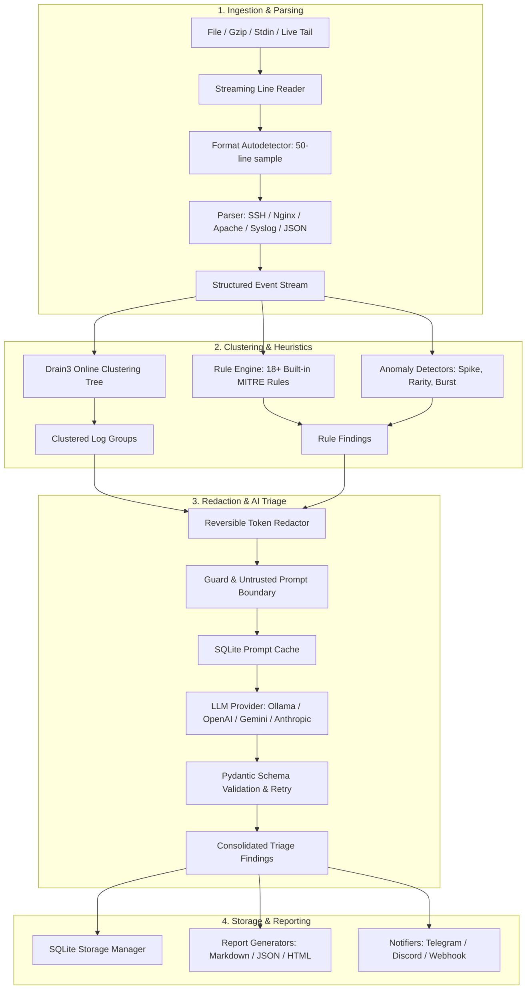

# System Architecture

LogLens is engineered as a high-throughput, security-first log triage pipeline that balances the deterministic precision of rule-based SIEM detection with the analytical contextualization of modern Large Language Models.

---

## 1. End-to-End Pipeline Overview

---

## 2. Architectural Components

### 2.1 Ingestion & Parsing
* **Streaming Reader** (`loglens.ingest.file`): Employs line-by-line generators supporting uncompressed plain text and `.gz` archives without reading entire files into RAM.
* **Format Autodetection** (`loglens.parsers.registry`): Examines the first 50 lines against all registered parser candidates. The parser achieving the highest valid parse ratio is automatically selected.
* **Parser Implementations**:
  - `AuthLogParser`: Parses Linux SSH authentication attempts (`sshd`), PAM failures, invalid users, and `sudo` privilege escalation commands.
  - `WebAccessParser`: Handles Nginx, Apache, and OpenLiteSpeed Combined Access log formats with HTTP status codes, verbs, and user-agents.
  - `SyslogParser`: Parses standard RFC 3164/5424 syslog lines with dynamic year-resolution for legacy formats lacking calendar years.
  - `JsonLinesParser`: Ingests structured JSON events with schema-flexible key mapping.
  - `GenericParser`: Regex-based resilient fallback for unstructured log formats.

### 2.2 Clustering & Anomaly Detection
* **Drain3 Algorithm** (`loglens.cluster.drain`): Hierarchical prefix tree algorithm parses log messages into constant templates by dynamically replacing variable parameters (IPs, numbers, tokens) with `<*>` wildcards.
* **Top-Field Extraction**: Each cluster retains frequency counts for key dimensions (e.g. usernames, source IPs, status codes, user-agents).
* **Rule Engine** (`loglens.rules.engine`): Evaluates YAML rules matching templates, status codes, or regex patterns with sliding time windows and count thresholds (`count: 5, window: 60s`).
* **Statistical Detectors** (`loglens.cluster.stats`):
  - **Spike Detection**: Flags sudden surges in cluster volume relative to historical averages.
  - **Rarity Detection**: Highlights anomalous log signatures appearing below a baseline frequency.
  - **Burst Detection**: Detects per-entity high-rate bursts across configured sliding windows.

### 2.3 Redaction & LLM Quarantine
* **Reversible Redactor** (`loglens.redact`): Regex engine replaces sensitive PII and secrets with surrogate markers:
  - IPv4 / IPv6 addresses
  - Email addresses
  - Authorization tokens (JWT, Bearer headers, API keys, AWS credentials)
* **Untrusted Prompt Boundary** (`loglens.llm.guard`):
  - Strips ANSI escape codes from untrusted strings.
  - Escapes delimiter tags (`<` to `&lt;`).
  - Wraps log telemetry in isolated `<untrusted_log_cluster>` XML containers.
* **Triage Orchestrator** (`loglens.llm.triage`): Coordinates model selection, token budget enforcement, cache queries, and JSON response repair routines.

### 2.4 Reporting, Storage & Alerts
* **SQLite Database** (`loglens.store.db`): Stores historical runs, clustered telemetry, findings, and prompt hashes. Handles automatic schema migrations and indexing.
* **Report Generators** (`loglens.report`):
  - `MarkdownReporter`: Generates clean, executive-ready markdown summaries with MITRE ATT&CK mappings.
  - `JsonReporter`: Exports versioned JSON conforming to `report_schema_version = "1.0.0"`.
  - `HtmlReporter`: Produces self-contained, XSS-escaped HTML dashboards with dark/light themes.
* **Alerting Dispatchers** (`loglens.notify`): Dispatches structured alerts to Discord, Telegram, or custom webhook endpoints with deduplication fingerprints and configurable cooldown intervals.
